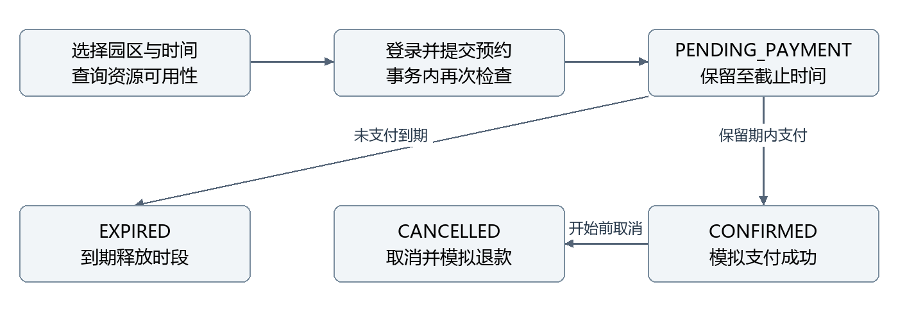
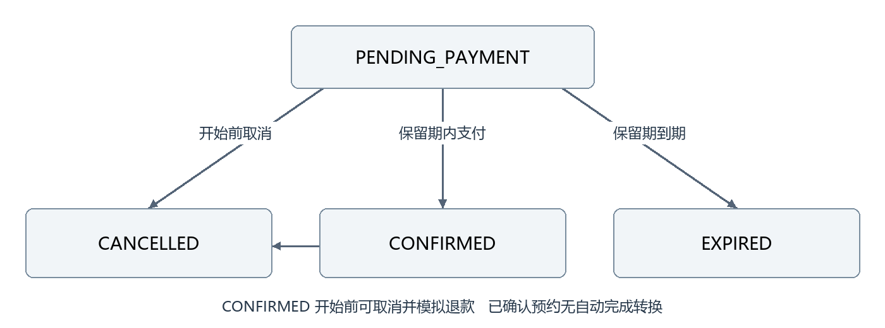
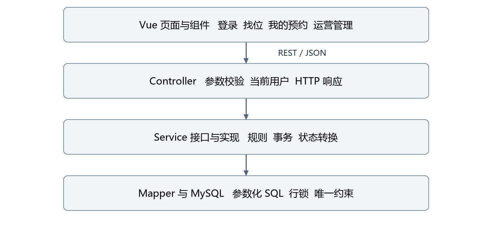
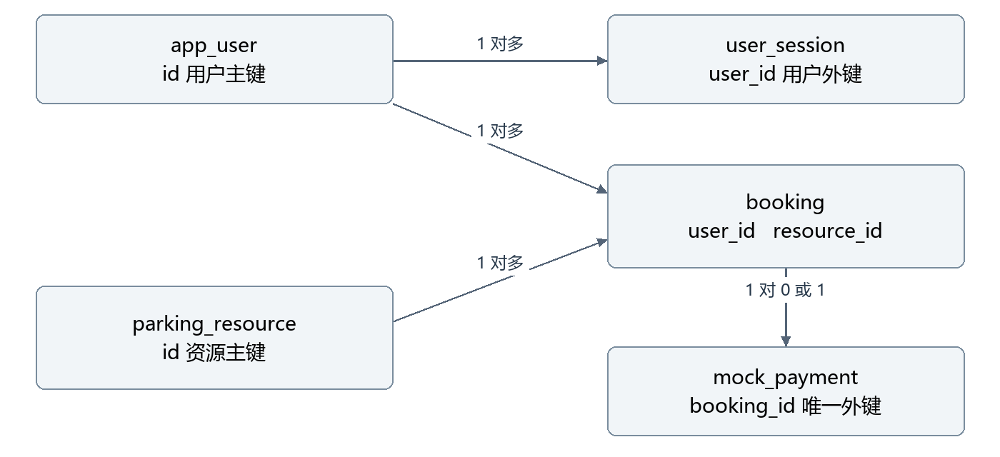

# 泊序停车充电预约平台
## 软件概要设计说明书

版本 1.0　第一阶段　2026 年 11 月 7 日

本文面向项目开发、测试与维护人员，说明泊序第一阶段的系统边界、总体架构、业务流程、数据组织和关键设计取舍。当前版本完成从登录、查询资源、预占时段、模拟支付到取消预约的闭环，为后续设备会话和 AI 能力提供预约基础。

文档编号 PARKING-HLD-001。设计基线为 D:\parking 的第一阶段实现，接口版本 1.0.0。对应详细设计为《软件详细设计说明书》PARKING-LLD-001。

| 版本 | 日期 | 变更内容 |
| --- | --- | --- |
| 1.0 | 2026-11-07 | 建立第一阶段概要设计基线 |

<!-- toc -->

# 1 项目概述

## 1.1 建设目标

园区车主到访前，希望按停车时间选择普通车位或充电车位，避免到场后无法找到可用资源。平台把资源、预约时段与支付状态关联起来，让车主能够查询可用性、锁定时段、完成模拟支付，并在开始前取消。

第一阶段的核心验收条件是：同一资源在任意相交时段内，只能存在一份有效占用。有效占用包括已支付预约和仍在保留期内的待支付预约。前端可用性只供查询参考，最终结果由创建预约时的数据库事务决定。

## 1.2 当前交付范围

| 能力 | 当前行为 | 业务边界 |
| --- | --- | --- |
| 用户认证 | 注册、登录、查询当前用户、退出 | 注册固定为普通用户 |
| 资源查询 | 园区、类型、时段可用性、详情 | 不包含地图和设备状态 |
| 时段预约 | 半小时时段、资源占用检查、请求幂等 | 不包含车牌占用去重 |
| 模拟支付 | 待支付转预约成功、重复支付返回原结果 | 不连接真实支付渠道 |
| 取消预约 | 开始前取消、已支付单模拟全额退款 | 不包含违约金和部分退款 |
| 运营管理 | 资源启用停用、全平台预约查询 | 管理员不能操作他人的支付或取消 |
| 前端界面 | 找位预约、我的预约、运营管理、使用指南 | 页面选择同日时段 |

充电车位在第一阶段是一类可预约资源，额定功率仅用于资料展示。费用是预约停车时段费用，不含电量、电费、设备控制或充电服务费。当前也没有自动完成预约、实际入场离场和停车充电会话。

## 1.3 设计依据与术语

本说明书与 README.md、docs/01-第一阶段设计.md、docs/02-接口文档.md、docs/04-测试验收报告.md、OpenAPI 文件及后端实际源码配套使用。数据库物理结构以 V1__schema.sql 为准，接口字段以 DTO、VO 和控制器为准。

| 术语 | 含义 |
| --- | --- |
| 资源 | 一个可被预约的普通或充电车位 |
| 预约 | 对指定资源和时间区间的预占记录 |
| 保留期 | 待支付预约暂时占用资源的有效期 |
| 请求幂等 | 同一业务请求重复提交只形成一份预约 |
| 价格快照 | 创建预约时复制的单价和应付金额 |
| Bearer 会话 | 客户端持有随机令牌并在请求头中提交的认证方式 |
| UTC | 后端处理和传输时间采用的统一时间基准 |

# 2 角色与业务设计

## 2.1 角色权限

系统只有 USER 和 ADMIN 两种持久化角色。未登录访客能够浏览公开资源。权限同时在接口入口和业务数据范围内校验，界面隐藏按钮只用于改善体验。

| 操作 | 访客 | USER | ADMIN |
| --- | --- | --- | --- |
| 查询园区与公开资源 | 允许 | 允许 | 允许 |
| 创建本人预约 | 需登录 | 允许 | 允许 |
| 查询本人预约 | 需登录 | 允许 | 允许 |
| 查询他人预约详情 | 需登录 | 不允许 | 允许 |
| 支付或取消他人预约 | 需登录 | 不允许 | 不允许 |
| 资源启停和全量查询 | 需登录 | 不允许 | 允许 |

管理员使用相同的本人预约流程。读取不可访问的预约或尝试操作他人预约时返回 404，避免通过订单 ID 判断他人订单是否存在。普通用户访问管理接口返回 403。

## 2.2 主业务流程

车主先选择园区、资源类型与起止时间。页面请求后端查询资源可用性；未登录时点击预约会先打开登录窗口，认证成功后继续原选择。提交预约后生成待支付记录，页面进入我的预约，用户在保留期内完成模拟支付。开始前取消已支付预约时，同一事务更新预约和模拟退款记录。

图 1 第一阶段用户预约流程

## 2.3 时段与金额规则

| 规则项 | 设计规定 |
| --- | --- |
| 起始时间 | 必须晚于服务端当前时间，最多提前 30 天 |
| 时间粒度 | 整点或半点，秒和纳秒不能形成额外偏移 |
| 单次时长 | 30 分钟至 24 小时，接口支持跨日 |
| 区间语义 | 左闭右开 [startAt, endAt)，相邻预约允许 |
| 预占截止 | min 当前时间加 5 分钟 与预约开始时间 |
| 费用 | 小时单价乘半小时段数再除以 2，保留两位小数 |
| 价格来源 | 服务端资源表，客户端不能指定价格 |
| 取消时间 | 预约开始前可取消；开始后拒绝取消 |
| 资源停用 | 阻止新预约，不改变已有预约 |

例如单价 6.00 元每小时，09:00 至 10:30 的费用为 9.00 元。09:00 至 10:00 与 10:00 至 11:00 不相交；09:30 至 10:30 与前者相交。后端以 BigDecimal 运算并采用 HALF_UP 舍入，避免浮点金额累计误差。

## 2.4 预约状态

图 2 预约状态与主要转换

| 状态 | 含义 | 是否占用时段 |
| --- | --- | --- |
| PENDING_PAYMENT | 待支付 | 仅 holdUntil 晚于当前时间时占用 |
| CONFIRMED | 模拟支付成功 | 占用自身预约区间 |
| CANCELLED | 已取消 | 不占用 |
| EXPIRED | 待支付保留期已过 | 不占用 |

重复支付已确认预约返回当前结果，重复取消已取消预约返回当前结果。过期预约的支付或取消返回 EXPIRED；其中支付不会产生支付记录。当前没有 COMPLETE 状态，已确认预约在时段结束后保留原状态作为历史记录，不会阻塞与其时间不相交的新预约。

# 3 总体架构

## 3.1 架构选择

采用前后端分离开发、同源打包部署的单体应用。Vue 前端负责交互和展示，Spring Boot 提供 REST 接口，MySQL 保存账号、会话、资源、预约及模拟支付。前端生产构建产物打入后端 JAR，因此本地访问一个地址即可体验全流程。

图 3 第一阶段逻辑架构

这一结构适合当前少量资源和本地演示的目标，业务事务均落在同一数据库。Redis、RabbitMQ、Elasticsearch、AI、网关和注册中心不属于当前运行依赖。

## 3.2 技术组成

| 技术 | 基线版本 | 在项目中的职责 |
| --- | --- | --- |
| Java | 17 | 服务端语言与时间金额处理 |
| Spring Boot | 3.5.16 | Web、配置、事务、调度、健康检查 |
| MyBatis-Plus | 3.5.18 | 常规数据访问，关键 SQL 使用 Mapper 注解 |
| MySQL | 本机 8.0.46 | 业务持久化、事务、行锁和唯一约束 |
| Flyway | 由后端依赖管理 | 启动时执行版本化数据库迁移 |
| Springdoc | 2.8.17 | OpenAPI 和 Swagger 文档 |
| BCrypt | spring-security-crypto | 密码摘要，不是完整 Spring Security 登录体系 |
| Vue 与 Vite | 3.5.45 与 6.4.5 | 组件化界面与前端构建 |
| Google Java Format 与 Prettier | 构建配置版本 | 统一代码格式 |
| JUnit 与 ArchUnit | ArchUnit 1.4.1 | 接口契约、并发正确性、依赖分层检查 |

## 3.3 三层职责

Controller 只接收参数、执行声明式校验、获取当前用户并组织响应；Service 接口声明业务能力，ServiceImpl 组合规则与事务；Mapper 完成数据库访问和显式加锁。Entity 对应持久化结构，DTO 和 VO 分别承担入参及输出契约，避免直接返回数据库实体。

| 层次 | 主要类型 | 依赖约束 |
| --- | --- | --- |
| 接口层 | AuthController、ResourceController、BookingController、AdminController | 依赖 Service 接口，不依赖 Mapper 或 Entity |
| 业务层 | AuthService、ResourceService、BookingService 及其实现 | 依赖 Mapper 和公共规则，不依赖 Controller |
| 数据层 | UserMapper、SessionMapper、ResourceMapper、BookingMapper、PaymentMapper | 处理参数化 SQL 和表记录 |
| 公共支持 | ApiResponse、Pages、BookingRules、异常处理、鉴权配置 | 不承载具体页面交互 |

类之间使用构造器注入。资源查询与预约创建复用 BookingMapper 的占用查询，不互相依赖具体 ServiceImpl。ArchUnit 在构建中检查上述分层约束。

## 3.4 模块协作

认证模块提供当前用户；资源模块提供可预约对象与可用性；预约模块负责生命周期、计价及模拟支付；管理接口复用资源和预约服务；调度模块清理过期状态。第一阶段模拟支付尚未独立为业务服务，其事务由 BookingServiceImpl 统一编排。

# 4 数据总体设计

## 4.1 数据实体关系

图 4 五张业务表的关联关系

| 表名 | 业务职责 | 主要约束 |
| --- | --- | --- |
| app_user | 账号与角色 | username 唯一 |
| user_session | 登录会话摘要与到期时间 | id 为令牌摘要主键，关联用户 |
| parking_resource | 资源、所属园区资料、费率与启停 | code 唯一 |
| booking | 时段预约、价格快照、状态及幂等键 | 单号唯一，用户与请求号组合唯一 |
| mock_payment | 模拟支付及退款状态 | booking_id 唯一，一单最多一条支付记录 |

园区没有独立的数据表，当前从 parking_resource 按 park_code 分组生成园区列表。园区资源数包含已停用资源，不是某个时段的剩余数量。Flyway 还维护自己的迁移历史表，该表不属于五张业务表。

## 4.2 数据一致性

预约保存 resource_code、park_name、resource_type、hourly_rate 和 amount 快照，使历史订单不随资源资料和费率变化而改变。外键维护用户、资源、预约与支付间的引用关系，业务状态目前由字符串枚举和服务层控制，没有数据库状态枚举或重叠区间排斥约束。

时段冲突无法仅靠普通唯一键解决，因此创建预约必须锁定资源行后执行重叠检查。用户与请求号唯一键、支付预约唯一键处理另一类问题，即重复业务请求和重复记账。两种机制职责不同。

## 4.3 数据库环境

业务库名为 parking，测试库为 parking_test，均采用 utf8mb4 字符集和 utf8mb4_0900_bin 排序规则。应用使用独立账号和环境变量连接数据库，真实密码保存在本机被忽略的 .env 中。MySQL 连接时区显式设为 UTC，界面显示使用 Asia/Shanghai。

数据库表结构由 Flyway 首次启动创建；演示初始化器补齐缺失账号和资源，不覆盖已有密码或预约历史。测试库中的业务数据会在自动化用例之间清理，不能作为业务库使用。

# 5 关键机制设计

## 5.1 预约防冲突

创建预约使用独立 TransactionTemplate，隔离级别为 READ_COMMITTED，事务超时为 15 秒。事务首先对目标 parking_resource 行执行 SELECT FOR UPDATE，然后再次检查幂等请求，校验时间和启停状态，查询重叠占用，最后插入预约并提交。

重叠条件是 existing.start_at < requested.end_at 且 existing.end_at > requested.start_at。占用状态限定为 CONFIRMED，或尚未过期的 PENDING_PAYMENT。同资源的创建请求因此串行经过检查，不同资源可以独立创建。

此保证成立的前提是所有创建路径都遵守资源锁流程，不能绕过服务直接写预约表。READ_COMMITTED 让等待锁的事务能够读取前一个持锁事务刚提交的预约。资源列表查询没有锁，也不承诺查询结果在提交预约时仍然有效。

## 5.2 幂等与重复操作

创建预约的业务键是 user_id 与 request_id。服务端对规范化后的资源 ID、车牌和两个时间生成 SHA-256 指纹。同键同指纹返回原预约的当前状态；同键不同指纹返回 409 IDEMPOTENCY_CONFLICT。重复提交不延长保留期，已取消或已过期的原请求也不会重新建单。

支付和取消在事务内锁定预约行，再根据当前状态处理。支付表的 booking_id 唯一约束进一步限制同一预约只产生一条记录。已支付取消将预约更新为 CANCELLED，并将原支付记录改为 REFUNDED，二者一起提交或回滚。

## 5.3 过期释放

定时任务以默认 30 秒固定延迟批量更新到期的待支付预约。查询本人或管理预约列表也触发一次过期更新；详情输出会即时把到期的待支付状态投影为 EXPIRED。更关键的是，占用查询始终排除 hold_until 不晚于当前时间的记录，因此资源释放不依赖调度任务恰好及时执行。

登录会话每小时清理一次过期数据，鉴权每次都单独检查 expires_at，所以清理延迟不会延长登录有效期。第一阶段使用单应用内调度，尚无独立任务平台与任务审计。

## 5.4 认证与安全

密码使用 BCrypt 摘要。登录返回 32 字节随机数据编码成的 Base64URL 令牌，数据库只保存其 SHA-256 摘要，有效期默认 24 小时。退出时删除当前会话；这不是 JWT，也没有刷新令牌。

WebConfig 拦截 /api/**，根据实际 HandlerMethod 上的公开或管理员注解决定是否验证用户和角色。业务服务再检查预约所属用户。JSON 未知字段会被拒绝，注册请求不能通过附带 role 字段获得管理员权限。前端令牌放在 sessionStorage 中，接口错误不向客户端输出 SQL、堆栈和凭证。

# 6 接口与前端设计

## 6.1 接口契约

接口采用 REST 风格，业务前缀为 /api，JSON 请求响应，时间为带时区 ISO 8601，响应时间统一 UTC，金额单位元。登录后使用 Authorization: Bearer <token>。成功和失败响应均包含 code、message、data、requestId，HTTP 状态与业务错误码配合使用。

| 分组 | 接口数量 | 主要能力 |
| --- | --- | --- |
| /api/auth | 4 | 注册、登录、当前用户、登出 |
| /api/parks 与 /api/resources | 3 | 园区、资源列表、资源详情 |
| /api/bookings | 5 | 创建、本人列表、详情、支付、取消 |
| /api/admin | 3 | 全资源、资源启停、全平台预约 |
| 合计 | 15 | 第一阶段业务操作 |

分页从第 1 页开始，默认每页 20 条，最大 100 条，按创建时间及 ID 降序。X-Request-Id 用于请求跟踪，与请求体中的预约幂等 requestId 含义不同。健康检查和 OpenAPI 属于技术接口，不计入 15 个业务操作。

## 6.2 前端交互

App.vue 管理页面视图、筛选条件、登录用户、预约列表与管理操作。AuthDialog、BookingDialog、BookingCard、ResourceCard、DialogShell 和 GuideView 分担可复用的页面职责。第一阶段不引入前端路由和全局状态库，页面通过内部视图状态切换。

筛选输入变化后等待 250 毫秒再请求资源，并立即使旧查询失效。资源和预约列表利用请求序号忽略过时响应，避免慢请求覆盖新条件。预约弹窗在一次生命周期中复用同一个 requestId，提交期间禁用按钮。支付和取消结束后重新查询列表，以后端最终状态显示结果。

页面倒计时只用于提示，服务端决定是否过期。当前前端只提供同日预约输入，而接口允许符合限制的跨日区间。页面展示金额是估算，最终应付金额取服务端的预约响应。

## 6.3 文档与联调

Springdoc 从控制器导出 OpenAPI。docs/openapi.json 和 docs/apifox-openapi.json 为本地导出版本，Apifox 可按 OpenAPI 格式导入。联调基地址为 http://localhost:8090，接口变更并重启后使用 scripts/export-openapi.ps1 重新导出。

# 7 部署与质量设计

## 7.1 本地部署拓扑

生产构建将前端静态资源放入后端 static 目录并打包为 JAR。浏览器访问本机 8090 端口，Spring Boot 通过连接池访问本机 3306 端口的 MySQL。开发时 Vite 使用 5173 端口，将 /api 代理到 8090。第一阶段不需要虚拟机 Docker 或 Redis。

| 配置项 | 默认或当前约定 |
| --- | --- |
| 应用端口 | SERVER_PORT 默认 8090 |
| 数据库地址 | MYSQL_HOST 默认 127.0.0.1，MYSQL_PORT 默认 3306 |
| 数据库名 | MYSQL_DATABASE 默认 parking |
| 数据库用户 | MYSQL_USER 默认 parking_app |
| 密码 | MYSQL_PASSWORD 由环境提供，无源码默认值 |
| 连接池 | 最大 16，连接等待 5000 毫秒 |
| 预约与会话 | 保留 5 分钟，会话 24 小时 |
| 演示数据 | SEED_ENABLED 默认 true |

scripts/build.ps1 完成格式检查、前端构建、后端测试和打包；start.ps1 加载本机配置启动服务，支持后台运行；stop.ps1 校验已记录的进程归属后停止。运行日志保存在 work 目录，数据库迁移和启动失败可通过日志定位。

## 7.2 已验证的质量结果

截至 2026 年 11 月 7 日的验收报告记载，执行 scripts/build.ps1 -MySqlTests 后共有 41 项测试通过，包含 3 项架构测试、19 项 H2 接口测试和 19 项真实 MySQL 接口测试，无失败、错误或跳过。测试明细可在配套验收报告及 Surefire XML 报告中查看。

10 路并发争抢同资源相同时段，仅 1 单成功，其余 9 单返回 409。相同请求号并发只生成一条预约，重复支付只生成一条支付记录。支付取消竞争、过期释放和越权访问也在接口测试覆盖范围内。

前端已进行 1440 像素桌面和 390 像素移动布局检查，并通过真实后端执行登录、预约、支付、取消退款及管理启停流程。现有证据证明规定场景的功能和并发正确性，不代表生产吞吐能力；尚未提供 QPS、延迟分位数和可用性指标。

## 7.3 当前限制

当前部署是本地演示结构，尚未配置面向公网的 TLS、登录限流、操作审计、备份恢复演练和完整监控。预约输出逐单读取支付记录，资源列表也没有分页，数据量扩大后需要优化。列表读取触发过期写入使查询存在副作用，后续可统一通过投影与后台任务处理。

还有一个需要优先补充验证的并发边界：支付只锁预约行，新建预约锁资源行。如果支付在保留期结束前通过检查，但提交跨过截止时间，同时新建请求已把原待支付单视为过期，则可能形成占用竞争。现有 10 路争抢测试没有证明这一截止边界安全；后续应统一锁协议或设计原子占用转换，并增加可控时钟的竞争测试。

当前版本适用于本地流程演示。进一步扩展前，应先处理已识别的并发边界，并建立更完整的测试、运维与容量证据。

# 8 演进方案与设计追踪

## 8.1 分阶段演进

| 阶段 | 计划增量 | 核心验收 | 当前状态 |
| --- | --- | --- | --- |
| 第一阶段 | 登录、资源、时段预约、模拟支付、取消、前端 | 同资源不重叠预约 | 已实现 |
| 第二阶段 | 模拟设备、停车充电会话、实际计费 | 重复与乱序事件不重复结算 | 未实现 |
| 第三阶段 | AI 查方案、规则问答、确认预约，可增加 RAG | 余量来自实时接口，写操作经授权确认 | 未实现 |
| 第四阶段 | 异常处理、监控、压测与 AI 评测 | 故障可追踪，性能和效果有记录 | 未实现 |

第二阶段宜保留预约作为计划，把实际入离场、充电开始停止建模为独立会话；第三阶段通过受控业务工具查询资源和提交预约，不能让模型直接写数据库。RAG 适合解释园区规则和计费说明，实时余量、订单和权限必须查询业务系统。

未来拆分微服务可按认证、资源预约、履约计费和 AI 编排划分候选边界。应先通过清晰接口隔离模块，再根据独立部署需要拆分；拆分后需重新设计跨服务支付、退款、消息幂等与补偿，不能直接把当前单库事务的保证搬过去。

## 8.2 需求与实现对应

| 需求 | 主要实现 | 验收依据 |
| --- | --- | --- |
| 用户身份与隔离 | AuthServiceImpl、WebConfig、预约归属检查 | 会话与越权接口用例 |
| 资源查询与启停 | ResourceServiceImpl、ResourceMapper.lock | 可用性和停用资源用例 |
| 时段不重叠 | BookingRules、资源锁、重叠 SQL | 区间和 10 路并发用例 |
| 请求幂等 | 指纹、组合唯一键、回滚后重读 | 重复请求与参数变化用例 |
| 支付取消一致 | 预约行锁、事务、支付唯一键 | 重复支付、退款和竞争用例 |
| 可读可维护 | 三层接口、DTO/VO、格式检查 | ArchUnit 与最终构建记录 |

开发与验收时应结合详细设计中的表字段、接口契约和状态分支检查。新增状态、写入入口或部署方式时，先更新对应设计与测试，再修改实现。
