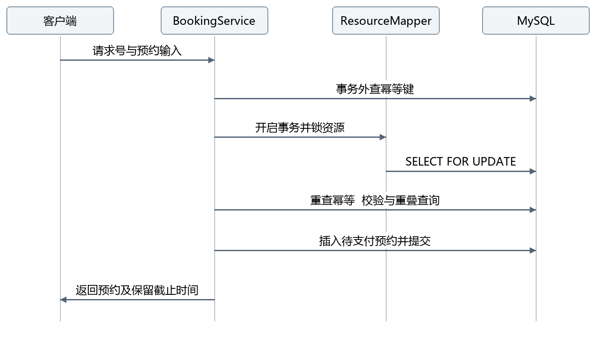
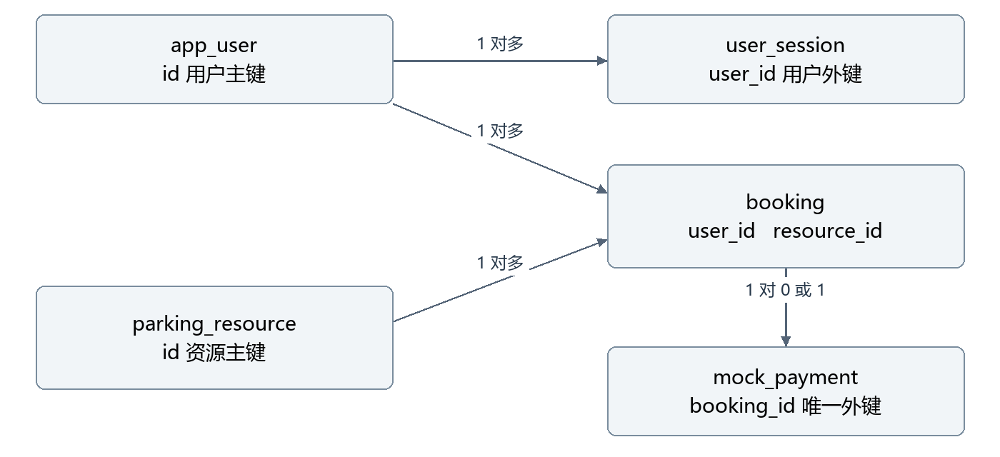

# 泊序停车充电预约平台
## 软件详细设计说明书

版本 1.0　第一阶段　2026 年 11 月 7 日

本文供项目开发、测试和维护人员使用，规定第一阶段的模块接口、数据字段、算法步骤、事务边界、页面行为和验证方法。维护人员可以据此定位实现，测试人员可以根据状态分支设计验收用例。

文档编号 PARKING-LLD-001。设计基线为 D:\parking 当前实现，配套概要设计编号 PARKING-HLD-001。代码路径除特别说明外均相对于项目根目录。未来设备、AI 和微服务能力不属于本版本实现。

| 版本 | 日期 | 变更内容 |
| --- | --- | --- |
| 1.0 | 2026-11-07 | 建立第一阶段详细设计及源码对应关系 |

<!-- toc -->

# 1 设计约定与代码组织

## 1.1 开发约定

后端包根为 com.parking，采用 Controller → Service 接口 → ServiceImpl → Mapper 的调用方向。Controller 不直接操作 Entity 或 Mapper；业务实现通过构造器注入依赖；请求与响应分别使用 record DTO 和 VO，持久化使用 Entity。代码使用 Google Java Format，前端使用 Prettier。

统一使用注入的 Clock 获取时间，Bean 为 UTC 毫秒时钟，便于测试替换。后端时间使用 Instant，金额使用 BigDecimal。API 输入须带时区；数据库连接使用 UTC，页面用 Asia/Shanghai 展示。数据库字段用下划线，Java 字段用驼峰，由 MyBatis 映射。

## 1.2 目录与类型

| 路径或类型 | 设计职责 |
| --- | --- |
| backend/src/main/java/com/parking/controller | 四个控制器，路由、参数、响应 |
| service 与 service/impl | 三个业务接口及各自实现 |
| mapper 与 entity | 五类数据对象与数据访问 |
| dto 与 vo | 四类请求 DTO 与五类业务 VO |
| common | 规则、枚举、异常、响应、分页、鉴权注解 |
| config | 拦截器、时钟、调度、演示初始化 |
| backend/src/main/resources/db/migration | V1__schema.sql 版本迁移 |
| frontend/src | Vue 组件、API 封装、格式化与样式 |
| scripts | 构建、启动、停止、数据库测试与文档导出 |

## 1.3 服务接口

| 接口 | 方法 | 输入与输出职责 |
| --- | --- | --- |
| AuthService | login、register | 请求 DTO → LoginView |
| AuthService | authenticate | Authorization → UserView |
| AuthService | logout | 当前 Authorization → 删除会话 |
| ResourceService | parks | 无参数 → List<ParkView> |
| ResourceService | list | 园区、类型、起止、含停用标志 → 资源列表 |
| ResourceService | get、setEnabled | ID 与可选启停值 → ResourceView |
| BookingService | create | UserView、CreateBookingRequest → BookingView |
| BookingService | get、pay、cancel | 当前用户与预约 ID → BookingView |
| BookingService | list | 用户、状态、页码、页大小、全量标志 → Pages<BookingView> |

认证与资源控制器分别调用对应服务。BookingController 处理本人预约，AdminController 复用资源及预约服务，不复制支付、计费或查询规则。业务服务中的 allUsers 参数仍做管理员校验，避免仅依赖接口路径限制数据范围。

# 2 公共响应与认证设计

## 2.1 统一响应和请求标识

ApiResponse<T> 包含 code、message、data、requestId。正常结果 code 为 OK，message 为 success；错误 data 为 null，错误信息面向用户，不返回数据库 SQL、堆栈、密码或令牌。业务失败使用 BusinessException 携带 HTTP 状态和业务码，由 GlobalExceptionHandler 转换。

```json
{
  "code": "OK",
  "message": "success",
  "data": {},
  "requestId": "example-http-trace"
}
```

HTTP 请求可携带 X-Request-Id，用于跟踪一次请求，只接受安全字符且最多 64 位；未提供或不合规则由服务生成。它与 CreateBookingRequest.requestId 不同：后者属于预约业务幂等键，必须在网络重试中复用。两种标识不能混用。

## 2.2 注册与登录

注册验证账号、密码和昵称，昵称去除首尾空白后仍不能为空。密码除字符长度约束外，还校验 UTF-8 编码不超过 72 字节，以符合 BCrypt 的输入限制。注册始终设置 USER；未知 JSON 字段拒绝解析，输入 role 会返回 400。

注册在同一事务中插入 app_user 与 user_session。username 唯一约束处理账号重复，异常映射为 409 CONFLICT。登录按账号查询后使用 BCrypt.matches；账号不存在时仍执行一次占位摘要匹配，账号不存在和密码错误使用相同的 401 INVALID_CREDENTIALS 响应。

## 2.3 会话签发与验证

每次登录生成 32 字节 SecureRandom 数据，使用不带填充的 Base64URL 编码为 43 位令牌。user_session.id 保存 SHA-256 的 64 位十六进制摘要，原始令牌仅返回客户端。会话默认有效 24 小时，无刷新令牌机制，重复登录可存在多个有效会话。

后续头部严格匹配 Bearer 加一个空格再加 43 位 URL 安全字符。服务将令牌摘要后查会话，验证 expires_at 严格晚于当前时间，再读取用户；任一步不满足返回 401 UNAUTHORIZED。退出删除当前摘要对应会话，不影响其他会话。

## 2.4 鉴权调用链

WebConfig 注册拦截器覆盖 /api/**。当处理器为 HandlerMethod 时，先检查 @PublicEndpoint，公开方法或类直接放行；其他接口执行 authenticate，将 UserView 写入请求属性供 UserContext.current 获取。标有 @AdminOnly 的类或方法进一步检查角色，非管理员返回 403。

拦截器对 API 响应设置 Cache-Control: no-store。预约详情允许本人或管理员读取；支付和取消始终要求本人，管理员角色不能绕过归属校验。健康和文档接口不在业务拦截路径中，仍可公开访问。

# 3 资源与预约创建设计

## 3.1 园区和资源查询

ResourceServiceImpl.parks 按 park_code、code 排序读取资源，使用 LinkedHashMap 按园区分组，取组内首条资料生成 ParkView，resourceCount 为该园区全部资源数。当前没有独立园区主数据管理，也不支持资源新增编辑接口。

list 接受 parkCode、type、startAt、endAt。起止时间必须同时提供或同时省略；提供时调用 BookingRules 校验，使用 BookingMapper.findBusyResourceIds 查询有效占用，并在资源映射时计算 available。公开列表过滤 enabled=true，管理员列表包含停用资源。

不带时间时 available 为 null，表示未计算而非不可用。get 返回基础资料，即使资源停用也可读取。setEnabled 开启事务并锁资源行后更新 enabled，与创建预约共用同一资源锁，因此启停与创建的先后以锁顺序和提交结果决定。

## 3.2 时间校验

BookingRules.validateWindow 依次检查：起止不能为空；开始必须晚于 now；开始不能晚于 now 加 30 天；结束必须晚于开始且时长不超过 24 小时；两个时点的纳秒须为 0，epochSecond 都能被 1800 整除。因为起止均半小时对齐且结束更晚，最短合法时长自然为 30 分钟。

30 天限制约束开始时间，结束仍受最长 24 小时约束，未额外限制结束必须在 now 加 30 天以内。边界按服务端实际时间判断，前端时钟不参与最终裁决。接口允许跨日，前端当前只生成同一日期的起止。

## 3.3 输入规范化与指纹

CreateBookingRequest 中资源 ID 转为小写，车牌字母转为大写；Instant 解析使带不同时区但表示同一时点的输入具有相同时间值。requestId 保持原样，服务端不主动 trim 车牌或请求号；前端提交车牌前先 trim。

指纹原文依次拼接 resourceId、plateNumber、startAt.toString、endAt.toString，以竖线分隔后计算 SHA-256。指纹不包含客户端价格，不接收客户端用户 ID。用户名、请求号的大小写也不能假设自动等价，数据库采用二进制排序规则。

## 3.4 创建事务顺序



图 1 创建预约及幂等校验时序

1. 规范化输入并生成指纹，在事务外按 user_id 和 request_id 查询已有预约；存在则执行 replay。
2. 不存在时进入 TransactionTemplate，隔离级别 READ_COMMITTED，超时 15 秒。
3. 使用 ResourceMapper.lock 对资源行 SELECT FOR UPDATE；资源不存在返回 404。
4. 获锁后再次查询幂等键，避免两个相同请求同时通过事务外检查。
5. 以获锁后的当前时间校验时段和 enabled；查询相交的有效占用，存在则返回 409 RESOURCE_UNAVAILABLE。
6. 创建 UUID 主键，生成 PK 加无连字符大写 UUID 的业务单号，保存资料和价格快照。
7. 写入 PENDING_PAYMENT、hold_until 和审计时间，插入 booking，事务提交后返回 BookingView。
8. 如果唯一键竞争导致 DuplicateKeyException，必须等本次事务完全回滚后再查胜者；查到同请求则 replay，否则继续抛出异常。

replay 比较 fingerprint：相同则返回原预约的当前视图，不重新校验新的预约窗口，也不延长 hold_until；不同返回 409 IDEMPOTENCY_CONFLICT。原单已取消或已过期时仍返回原单，需要重新预约应生成新的业务 requestId。

## 3.5 重叠 SQL 与锁语义

```sql
SELECT DISTINCT resource_id
FROM booking
WHERE start_at < :end
  AND end_at > :start
  AND (status = 'CONFIRMED'
       OR (status = 'PENDING_PAYMENT'
           AND hold_until > :now))
  -- 创建预约时附加此条件，资源列表查询时省略
  AND resource_id = :resourceId;
```

上述为便于阅读的参数化 SQL 表达，源码使用 MyBatis #{参数} 与动态 if。相邻区间不匹配严格小于和大于，因此允许连续预约。取消或过期预约不参与占用。

资源行锁是同一资源写入的互斥点；重叠查询自身不是 FOR UPDATE，也没有单独锁所有时间区间。READ_COMMITTED 确保获锁后的查询可看见上一事务提交的记录。所有新增预约入口必须遵守相同流程，数据库唯一键本身不能证明时段不重叠。

当前支付与取消只锁预约行。一般情况下，支付把未过期的占用转换为已确认占用，取消释放占用；并发取消时新建可能暂时看到旧占用而拒绝，用户可重新尝试。支付检查和事务提交跨越保留截止时间时，不能仅凭这两个不同锁对象推导出完整的不重叠保证，详见第十章的待处理边界。

## 3.6 计价与快照

先求 halfHours = 起止分钟差 / 30，再计算 amount = hourlyRate × halfHours / 2，以两位小数和 HALF_UP 取整。合法输入的分钟差必为 30 的整数倍。客户端即使显示浮点估算，也不能覆盖服务端金额。

| 小时费率 | 时长 | 半小时段数 | 应付元 |
| --- | --- | --- | --- |
| 6.00 | 30 分钟 | 1 | 3.00 |
| 6.00 | 90 分钟 | 3 | 9.00 |
| 8.00 | 3 小时 | 6 | 24.00 |
| 6.00 | 24 小时 | 48 | 144.00 |

保存快照可使后续资源费率改变后，历史订单及模拟退款仍依据原金额。第一阶段没有额外优惠、阶梯价格、封顶价、电量价或真实支付手续费。

# 4 支付取消和过期设计

## 4.1 模拟支付

pay 标注 @Transactional，首先通过 BookingMapper.lock 锁预约行并检查所属用户。到期判断先于状态分支：若已经 EXPIRED，或待支付且 hold_until 不晚于当前时间，返回 EXPIRED；后者同时写入过期状态，不插入支付记录。

若已 CONFIRMED，直接返回当前结果；若不是 PENDING_PAYMENT，返回 409 CONFLICT。合法待支付单创建 mock_payment，金额取预约快照，状态 SUCCESS；随后更新预约为 CONFIRMED 并写 paid_at、updated_at，同事务提交。

同预约多次支付的正确性来自预约行锁与状态检查，uk_payment_booking 再提供唯一约束。该实现只有同步本地模拟流程，不涉及第三方回调、对账或跨系统资金一致性。

## 4.2 取消与模拟退款

cancel 同样开启事务、锁预约并验证本人。已过期返回 EXPIRED，已取消返回原结果。其余状态检查 start_at 必须严格晚于 now；已开始返回 409。待支付单直接取消，已确认单先查询原支付记录，将状态置为 REFUNDED 并写 refunded_at，再把预约置为 CANCELLED，写取消和更新时间。

若已确认单缺少支付记录，视为服务端数据异常，抛错回滚，避免形成仅部分更新的状态。重复取消不会插入第二笔退款，因为退款只是同一支付记录的状态更新。

## 4.3 操作状态矩阵

| 当前预约状态 | 支付结果 | 取消结果 | 支付记录 |
| --- | --- | --- | --- |
| PENDING_PAYMENT 且未到期 | CONFIRMED | 开始前 CANCELLED | 支付创建 SUCCESS，取消不创建 |
| PENDING_PAYMENT 且到期 | EXPIRED | EXPIRED | 不创建 |
| CONFIRMED | 原结果 | 开始前 CANCELLED | 取消时由 SUCCESS 改 REFUNDED |
| CONFIRMED 且已开始 | 原结果 | 409 | 原 SUCCESS 保留 |
| CANCELLED | 409 | 原结果 | 保留 UNPAID 投影或原 REFUNDED |
| EXPIRED | 原 EXPIRED | 原 EXPIRED | 不创建 |

CONFIRMED 重复支付在开始后也仍是幂等读取，不代表新一次支付。所有分支都在归属校验后执行；不可访问订单一律 404。

## 4.4 过期任务与响应投影

ExpiryJob.expireBookings 以 parking.expiry-delay-ms 控制固定延迟，默认 30000 毫秒，执行一条 UPDATE，将 PENDING_PAYMENT 且 hold_until <= now 的记录改为 EXPIRED 并写 updated_at。expireSessions 每 3600000 毫秒删除到期会话。

BookingServiceImpl.list 在构造分页前执行 expireDue，保证 EXPIRED 状态筛选及时生效。get 和 replay 的 toView 对到期待支付单投影 EXPIRED，但不保证该读取会写回状态。支付取消中的 expireIfNeeded 会在锁内落库。可用性 SQL 则直接判断保留期，故数据清理延迟不等于占用延长。

toView 按 booking_id 查模拟支付，无记录输出 UNPAID；有记录输出 SUCCESS 或 REFUNDED。canCancel 由开始时间和有效状态推导，是展示提示；后端写操作重新检查，不依赖页面传回该值。

## 4.5 事务边界汇总

| 操作 | 事务与锁 | 一致性目标 |
| --- | --- | --- |
| 注册 | @Transactional | 用户和初始会话同时提交 |
| 创建预约 | TransactionTemplate，READ_COMMITTED，15 秒；资源行锁 | 资源检查与插入不可被同资源创建穿插 |
| 模拟支付 | @Transactional；预约行锁 | 支付记录和确认状态同时提交 |
| 取消预约 | @Transactional；预约行锁 | 取消和模拟退款同时提交 |
| 启停资源 | @Transactional；资源行锁 | 与资源创建预约串行协调 |
| 过期更新 | 单条条件 UPDATE | 仅更新仍为待支付的到期单 |

除创建预约外，声明式事务使用数据源默认隔离配置，代码没有显式改为 READ_COMMITTED。数据库访问错误统一转换 503；前端重试创建必须复用原 requestId，避免不确定提交结果生成重复业务单。

# 5 数据库物理设计

## 5.1 通用存储约定

业务库 parking，测试库 parking_test；MySQL 8.0，utf8mb4，utf8mb4_0900_bin。所有业务主键为应用生成的 UUID 字符串，长度 36；会话表主键是令牌摘要，长度 64。TIMESTAMP(6) 保存时点，连接时区设置为 UTC。以下字段字典中 NN 表示 NOT NULL，空白默认表示未声明 SQL DEFAULT，需由应用赋值。



图 2 用户资源预约及模拟支付关联

## 5.2 用户表 app_user

| 字段 | 类型 | 空值与默认 | 说明 |
| --- | --- | --- | --- |
| id | VARCHAR(36) | NN，主键 | 用户 ID |
| username | VARCHAR(32) | NN | 登录账号，uk_user_username 唯一 |
| password_hash | VARCHAR(100) | NN | BCrypt 摘要 |
| display_name | VARCHAR(40) | NN | 昵称 |
| role | VARCHAR(16) | NN | USER 或 ADMIN，应用控制 |
| created_at | TIMESTAMP(6) | NN | 创建时间 |

账号大小写在数据库层可区分，当前没有账号归一化逻辑。表中不存储明文密码，UserView 不暴露 password_hash。

## 5.3 会话表 user_session

| 字段 | 类型 | 空值与默认 | 说明 |
| --- | --- | --- | --- |
| id | VARCHAR(64) | NN，主键 | 原始令牌 SHA-256 摘要 |
| user_id | VARCHAR(36) | NN | 外键指向 app_user.id |
| expires_at | TIMESTAMP(6) | NN | 到期时间 |
| created_at | TIMESTAMP(6) | NN | 签发时间 |

fk_session_user 维护用户引用；idx_session_expiry(expires_at) 支持到期清理。鉴权按摘要主键查找，不需要扫描令牌列表。

## 5.4 资源表 parking_resource

| 字段 | 类型 | 空值与默认 | 说明 |
| --- | --- | --- | --- |
| id | VARCHAR(36) | NN，主键 | 资源 ID 与资源锁对象 |
| code | VARCHAR(32) | NN | 资源编号，全局唯一 |
| park_code | VARCHAR(32) | NN | 园区代码 |
| park_name | VARCHAR(60) | NN | 园区名称 |
| location | VARCHAR(100) | NN | 园区位置说明 |
| resource_type | VARCHAR(16) | NN | PARKING 或 CHARGING |
| power_kw | INT | NN，0 | 额定功率，展示用途 |
| hourly_rate | DECIMAL(10,2) | NN | 每小时停车费，元 |
| enabled | BOOLEAN | NN，TRUE | 是否接受新预约 |
| created_at | TIMESTAMP(6) | NN | 创建时间 |

uk_resource_code(code) 保证编号唯一。idx_resource_park_type(park_code, resource_type) 对应园区和类型筛选。当前资源没有单独的物理设备编号、实时心跳或占用传感器字段。

## 5.5 预约表 booking

| 字段 | 类型 | 空值与默认 | 说明 |
| --- | --- | --- | --- |
| id | VARCHAR(36) | NN，主键 | 预约 ID |
| booking_no | VARCHAR(40) | NN | PK 前缀业务单号，唯一 |
| user_id | VARCHAR(36) | NN | 用户外键 |
| request_id | VARCHAR(64) | NN | 客户端业务请求号 |
| fingerprint | VARCHAR(64) | NN | 规范化输入摘要 |
| resource_id | VARCHAR(36) | NN | 资源外键 |
| resource_code | VARCHAR(32) | NN | 资源编号快照 |
| park_name | VARCHAR(60) | NN | 园区名快照 |
| resource_type | VARCHAR(16) | NN | 资源类型快照 |
| plate_number | VARCHAR(16) | NN | 规范化车牌 |
| start_at | TIMESTAMP(6) | NN | 预约开始 |
| end_at | TIMESTAMP(6) | NN | 预约结束，不包含该时点 |
| hourly_rate | DECIMAL(10,2) | NN | 创建时单价 |
| amount | DECIMAL(10,2) | NN | 应付停车费 |
| status | VARCHAR(24) | NN | 四种预约状态 |
| hold_until | TIMESTAMP(6) | NN | 待支付保留截止 |
| paid_at | TIMESTAMP(6) | 可空 | 模拟支付时间 |
| cancelled_at | TIMESTAMP(6) | 可空 | 取消时间 |
| created_at | TIMESTAMP(6) | NN | 创建时间 |
| updated_at | TIMESTAMP(6) | NN | 最后业务更新时间 |

fk_booking_user 指向 app_user，fk_booking_resource 指向 parking_resource。hold_until 在确认或取消后仍保留原值用于记录，不再决定该状态是否有效。paid_at 在退款后也保留原支付时间。

| 索引名 | 索引列 | 作用 |
| --- | --- | --- |
| uk_booking_no | booking_no，唯一 | 业务单号不重复 |
| uk_booking_request | user_id、request_id，唯一 | 同用户请求幂等 |
| idx_booking_resource_time | resource_id、start_at、end_at、status | 同资源占用检索的候选索引 |
| idx_booking_user_created | user_id、created_at、id | 本人列表及稳定排序 |
| idx_booking_expiry | status、hold_until | 到期待支付更新 |

区间查询包含范围条件，不能假设复合索引所有列都能被完整用于定位；扩大数据规模后应通过 EXPLAIN 和真实负载评估。全资源时段查询和管理员全量分页也没有独立优化方案。

## 5.6 模拟支付表 mock_payment

| 字段 | 类型 | 空值与默认 | 说明 |
| --- | --- | --- | --- |
| id | VARCHAR(36) | NN，主键 | 支付记录 ID |
| booking_id | VARCHAR(36) | NN | 预约外键，唯一 |
| amount | DECIMAL(10,2) | NN | 原预约金额 |
| status | VARCHAR(16) | NN | SUCCESS 或 REFUNDED |
| paid_at | TIMESTAMP(6) | NN | 支付时间 |
| refunded_at | TIMESTAMP(6) | 可空 | 模拟退款时间 |

fk_payment_booking 指向 booking，uk_payment_booking 限制一份预约最多一条记录。UNPAID 只存在于响应投影，不落为支付表记录。没有单独退款流水、支付渠道单号或资金账户。

## 5.7 迁移与初始数据

Flyway 管理 V1__schema.sql，初次启动创建五张表及索引、外键。部署到新环境时先创建数据库和应用账号，再由迁移创建表。已应用的迁移文件不应直接修改，后续结构变化应新增版本迁移。

DemoDataInitializer 在 seed-enabled 为 true 时补齐演示数据：两个园区，每个三普通车位、三充电车位；资源 A-001 至 A-006、B-001 至 B-006，费率分别为 6.00 与 8.00。充电资源展示 60 或 120 kW。初始化只补缺失记录，不覆盖历史预约、已存在资源或账号密码。

# 6 接口详细设计

## 6.1 通用约定

本地基地址 http://localhost:8090。除注明公开外均要求 Bearer 会话。请求 Content-Type 为 application/json；所有业务返回包在 ApiResponse 中。注册成功 HTTP 201，其他成功 HTTP 200。预约创建首次成功与幂等重放都返回 200。

以下写明的是 data 的业务类型；实际 JSON 外层还包含统一响应字段。路径 id 为资源或预约 ID，当前路径参数没有单独严格 UUID 格式注解，格式不匹配通常表现为查无数据。

## 6.2 认证接口

| 方法与路径 | 权限 | 请求 | 返回 data |
| --- | --- | --- | --- |
| POST /api/auth/register | 公开 | RegisterRequest | LoginView，201 |
| POST /api/auth/login | 公开 | LoginRequest | LoginView |
| GET /api/auth/me | 登录 | 无 | UserView |
| POST /api/auth/logout | 登录 | 无正文 | null |

| DTO 字段 | 类型 | 约束 |
| --- | --- | --- |
| username | String | 登录注册共用，3 至 32 位 ASCII 字母数字下划线 |
| password | String | 8 至 64 字符，UTF-8 不超过 72 字节，不可空白 |
| displayName | String | 仅注册，最多 40 字符，trim 后非空 |

LoginView 字段为 token、expiresAt、user。UserView 字段为 id、username、displayName、role。账号错误返回 401，重复账号返回 409。退出会话后，再使用原令牌访问 me 返回 401。

## 6.3 资源接口

| 方法与路径 | 权限 | 请求与输出 |
| --- | --- | --- |
| GET /api/parks | 公开 | 无参数，返回 List<ParkView> |
| GET /api/resources | 公开 | 可选园区、类型、起止，返回 List<ResourceView> |
| GET /api/resources/{id} | 公开 | 路径 ID，返回 ResourceView，缺失 404 |

resources 查询参数 parkCode 为园区代码，type 为 PARKING 或 CHARGING，startAt 与 endAt 为带时区时间。起止缺一、时间非法或枚举非法返回 400。列表仅返回启用资源，传时段只计算 available，不自动过滤不可用资源；页面的仅看可用选项在前端过滤。

ParkView 为 code、name、location、resourceCount。ResourceView 为 id、code、parkCode、parkName、location、type、powerKw、hourlyRate、enabled、available。其中 available 可为 null，其余布尔启停值不代表物理设备状态。

## 6.4 创建预约接口

POST /api/bookings 要求登录，正文使用 CreateBookingRequest，返回 BookingView。调用者身份从会话读取，不接收 userId、amount、status 或 role。多传未知字段会返回 400。

| 字段 | 类型 | 必填 | 校验与含义 |
| --- | --- | --- | --- |
| requestId | String | 是 | 1 至 64 位字母数字下划线连字符，业务幂等 |
| resourceId | String | 是 | 长度 36，字符限十六进制与连字符；存在性再查库 |
| plateNumber | String | 是 | 5 至 10 位汉字字母数字，非真实号牌鉴别 |
| startAt | Instant | 是 | ISO 8601，符合预约窗口规则 |
| endAt | Instant | 是 | 同上，严格晚于开始 |

resourceId 的当前正则只检查字符范围和长度，不校验 UUID 各段结构。车牌正则也只用于演示格式，不校验真实车辆归属。

```json
{
  "requestId": "apifox-booking-001",
  "resourceId": "替换为资源列表返回的真实ID",
  "plateNumber": "浙A12345",
  "startAt": "2026-11-08T09:00:00+08:00",
  "endAt": "2026-11-08T12:00:00+08:00"
}
```

示例日期仅用于解释，测试时应替换为当时未来且符合限制的时间，资源 ID 也须从接口获取。时段占用返回 409 RESOURCE_UNAVAILABLE，改变已有 requestId 参数返回 409 IDEMPOTENCY_CONFLICT，停用资源返回 409 CONFLICT。

## 6.5 预约查询与操作接口

| 方法与路径 | 权限 | 语义 |
| --- | --- | --- |
| GET /api/bookings | 登录 | 本人分页，可选 status、page、size |
| GET /api/bookings/{id} | 本人或 ADMIN | 返回预约详情，无权或缺失 404 |
| POST /api/bookings/{id}/pay | 仅本人 | 无正文，模拟支付，返回 BookingView |
| POST /api/bookings/{id}/cancel | 仅本人 | 无正文，开始前取消，返回 BookingView |

status 为四种 BookingStatus 之一；page 默认 1，size 默认 20，范围 1 至 100。分页 data 为 items、page、size、total；按 created_at、id 降序。当前 Pages 先 count，再 LIMIT/OFFSET 查询，不保证两次查询之间的全局快照一致。

支付即使返回 HTTP 200，也可能是 EXPIRED；调用者必须读取 status。已取消单支付、开始后取消返回 409。重复合法操作的返回以第四章状态矩阵为准。

## 6.6 预约返回对象

| BookingView 字段 | 类型 | 含义 |
| --- | --- | --- |
| id、bookingNo | String | 技术主键与业务单号 |
| resourceId、resourceCode | String | 资源关联与编号快照 |
| parkName、type | String 与枚举 | 园区名及资源类型快照 |
| plateNumber | String | 规范化车牌 |
| startAt、endAt | Instant | UTC 起止 |
| hourlyRate、amount | BigDecimal | 元，单价快照与应付费用 |
| status | BookingStatus | 预约当前有效状态投影 |
| holdUntil | Instant | 原待支付截止 |
| paidAt、cancelledAt | Instant 或 null | 已支付、已取消时间 |
| createdAt | Instant | 建单时间 |
| paymentStatus | String | UNPAID、SUCCESS、REFUNDED |
| canCancel | boolean | 当前时间和状态是否允许取消的提示 |

输出不包含 user_id、request_id、fingerprint、密码或会话摘要。管理员列表也复用此视图，因此当前不能直接从列表拿到预约用户账号；如运营需要，应设计专用视图和必要的数据权限。

## 6.7 管理接口

| 方法与路径 | 权限 | 请求与输出 |
| --- | --- | --- |
| GET /api/admin/resources | ADMIN | 无筛选参数，返回全资源，available=null |
| PATCH /api/admin/resources/{id}/status | ADMIN | ResourceStatusRequest → ResourceView |
| GET /api/admin/bookings | ADMIN | 同预约分页参数，跨用户查询 |

ResourceStatusRequest 只有 enabled，类型 Boolean，必填且不能为 null。停用不取消原预约，不冻结其支付；该规则必须在界面明确提示。管理接口默认拒绝 USER，隐藏导航不是权限边界。

## 6.8 错误协议

| HTTP | code | 触发条件与客户端处理 |
| --- | --- | --- |
| 400 | VALIDATION_ERROR | DTO 或业务输入规则错误，提示修正 |
| 400 | BAD_REQUEST | JSON、枚举、参数解析错误 |
| 401 | INVALID_CREDENTIALS | 登录凭证错误，保留登录表单 |
| 401 | UNAUTHORIZED | 未登录或会话失效，清理会话 |
| 403 | FORBIDDEN | 管理权限不足 |
| 404 | NOT_FOUND | 对象缺失或不可访问 |
| 405 | METHOD_NOT_ALLOWED | 路径存在但 HTTP 方法不支持 |
| 409 | RESOURCE_UNAVAILABLE | 所选资源时段已占用，重选 |
| 409 | IDEMPOTENCY_CONFLICT | 复用请求号却改变参数 |
| 409 | CONFLICT | 重复记录、停用或状态不支持 |
| 503 | DEPENDENCY_UNAVAILABLE | 数据库错误，保留业务请求号重试 |
| 500 | INTERNAL_ERROR | 未预期异常，按请求标识排查 |

GlobalExceptionHandler 只将校验错误中的一个字段提示返回客户端；数据库错误日志记录异常类别，未预期异常记录服务器堆栈。requestId 当前用于响应跟踪，并未构建完整的分布式追踪系统。

# 7 前端详细设计

## 7.1 组件职责

| 文件 | 主要状态或输入 | 行为 |
| --- | --- | --- |
| App.vue | user、view、filters、列表和弹窗状态 | 页面编排、筛选、管理、刷新 |
| AuthDialog.vue | 登录注册表单 | 认证后保存 token 并通知主页面 |
| BookingDialog.vue | resource、window、plate、requestId | 展示估算、提交预约、错误提示 |
| ResourceCard.vue | 资源与加载状态 | 展示可用性、触发预约 |
| BookingCard.vue | 预约与当前时间 | 状态、倒计时、支付取消入口 |
| DialogShell.vue | 标题、busy | 通用弹窗容器 |
| GuideView.vue | 无业务持久状态 | 使用步骤和边界提示 |
| api.js | sessionStorage 会话 | fetch、认证头、统一错误 |
| format.js | 日期时间与金额 | 时区展示和输入区间构造 |

## 7.2 查询与页面状态

找位页面由园区、类型、日期、起止和仅看可用等筛选组成。App 的 resourceSequence 在筛选变化时立即递增，使旧结果失效，再用 250 毫秒延迟合并输入变化；响应只有序号仍匹配时才能更新资源和当前时间窗口。加载期间不能点击预约，避免旧列表与新时间组合。

预约列表使用 listSequence，保证较早返回的筛选或分页结果不能覆盖更新结果。本人和管理预约列表每页请求 8 条；API 默认 20 条并不等于页面固定大小。管理资源列表当前没有同样的请求序号机制，后续交互更复杂时应补齐。

## 7.3 登录与提交

未登录预约时暂存 pendingResource 和选定时间，打开 AuthDialog；认证后继续 BookingDialog。初始化存在令牌时先请求 me，失败则清理。api.js 在非登录凭证错误的 401 时删除 token 并发出 parking-session-expired 事件，主页面清理用户和操作弹窗。

BookingDialog 每次实例创建一个 crypto.randomUUID 作为 requestId，同一表单重试复用；提交期间 busy 禁用按钮。前端 trim 并大写车牌，金额只展示估算。网络失败后若修改了输入仍复用同一 requestId，可能得到幂等冲突；可关闭弹窗重新查询原单，再决定开启新预约，不能盲目换号重试。

支付、取消和启停资源均通过操作弹窗确认，提交期间禁用。成功后刷新相应列表；支付返回 EXPIRED 时显示过期提示。倒计时每秒刷新只是本地显示，最终以 API 返回状态为准。组件卸载会清理定时器和事件监听。

## 7.4 API 封装与视觉适配

api.js 统一添加 Accept、按需 Content-Type 和 Authorization，网络不可达或非 JSON 响应转为可读错误。非成功 HTTP 结果保留 code、status、requestId 供界面处理，成功返回 data。

页面采用原生 CSS 和本地 SVG 图标，未依赖外部字体、图片和地图服务。现有桌面和移动适配的验收尺寸为 1440 像素与 390 像素；这不是对所有终端的兼容性承诺。前端状态管理与视图切换使用 Vue Composition API，当前没有 Vue Router 或 Pinia。

# 8 配置部署与运行维护

## 8.1 环境配置

| 配置 | 默认值或职责 |
| --- | --- |
| SERVER_PORT | 8090 |
| MYSQL_HOST、MYSQL_PORT | 127.0.0.1、3306 |
| MYSQL_DATABASE | parking，测试脚本固定使用 parking_test |
| MYSQL_USER | parking_app |
| MYSQL_PASSWORD | 必须由本机环境提供，本文不记录真实值 |
| SEED_ENABLED | true，控制演示初始化 |
| parking.hold-minutes | 5，配置文件中的保留分钟数 |
| parking.session-hours | 24，配置文件中的会话小时数 |
| parking.expiry-delay-ms | 调度表达式默认 30000 毫秒 |
| Hikari maximum-pool-size | 16 |
| Hikari connection-timeout | 5000 毫秒 |

数据源 URL 显式声明 connectionTimeZone=UTC、serverTimezone=UTC 和 UTF-8。Jackson fail-on-unknown-properties 为 true。Actuator 暴露 health 和 info，Swagger 路径由 Springdoc 提供。默认本地 HTTP 仅用于演示，公网部署前应增加 TLS 与相应运行保护。

## 8.2 构建和运行

在 D:\parking 中执行以下命令。脚本加载被版本控制忽略的 .env；本文只描述变量，不收录真实数据库凭证。

```powershell
.\scripts\build.ps1 -MySqlTests
.\scripts\start.ps1 -Background
.\scripts\stop.ps1
```

构建先检查前端格式并生成生产静态文件，再执行后端格式检查、测试和打包。打包后的浏览器入口为 http://localhost:8090。前端独立开发在 frontend 目录运行 npm.cmd ci 和 npm.cmd run dev，Vite 5173 的 /api 代理至 8090。

start.ps1 支持 -Build 重新构建，后台进程 PID 记在 work/app.pid；日志在 work/app.log 和 work/app-error.log。停止脚本校验记录的进程确实是本项目 Java JAR 后再终止。重新打包前应停止正在使用旧 JAR 的进程。

## 8.3 接口与故障排查

在线契约 /v3/api-docs，Swagger /swagger-ui/index.html，健康 /actuator/health。scripts/export-openapi.ps1 在应用启动后导出 docs/openapi.json 与 docs/apifox-openapi.json；导入 Apifox 时选择 OpenAPI/Swagger 格式，设置本地基地址并从登录响应保存 token。

数据库连接失败先检查应用启动日志、端口、专用账号权限和环境变量；503 表示数据库访问失败，不应直接向页面展示底层 SQL。409 时段冲突需要重新查资源，幂等冲突需要检查是否复用了旧业务请求号。重试前判断原业务是否已经提交，不能仅靠页面网络报错推断数据库回滚。

## 8.4 数据维护约束

不手动修改原始迁移文件，不绕过服务直接插入有效预约，不用业务库跑清表测试。资源资料变更须保留历史快照语义。当前未提供数据库备份恢复脚本、审计导出或订单数据归档，这些能力需在长期使用前补齐。

# 9 测试设计与证据

## 9.1 测试结构

ParkingApiTest 用 H2 执行 19 项接口契约用例；MySqlApiTest 在真实 parking_test 数据库执行相同的 19 项用例；ArchitectureTest 用 3 项规则检查分层依赖。两套接口测试用于发现数据库行为差异，H2 通过不能代替 MySQL 行锁验证。

2026 年 11 月 7 日验收记录的最终命令为 scripts/build.ps1 -MySqlTests，41 项全部通过，失败、错误、跳过均为 0。报告在 backend/target/surefire-reports，完整日志在 work/build-final.log。测试明细与执行环境以配套验收记录为准。

## 9.2 关键用例与预期

| 场景 | 输入或操作 | 核心断言 |
| --- | --- | --- |
| 区间冲突 | 相同、部分交叉、包含时段 | 后续预约 409 |
| 相邻区间 | 前一单结束等于后一单开始 | 可同时成立 |
| 同资源并发 | 10 路不同请求号争同一时段 | 1 次 200，9 次 409，无双订 |
| 幂等并发 | 10 路同用户同请求号同参数 | 仅一条预约，返回同 ID |
| 幂等参数变化 | 同请求号改变车牌资源或时间 | 409，不改原单、不延长保留 |
| 重复支付 | 10 路支付同预约 | 一条 mock_payment |
| 支付取消竞争 | 并发对同预约操作 | 最终取消，不残留 SUCCESS 支付 |
| 到期支付 | 令保留期到期后请求支付 | EXPIRED，无支付记录 |
| 越权访问 | 另一用户读取支付取消 | 404；普通用户管理接口 403 |
| 停用资源 | 停用后创建与处理旧单 | 新建失败，旧单规则仍有效 |
| 定价快照 | 半小时与修改当前资源费率 | 金额和原单单价稳定 |
| 注册与会话 | 额外 role、登出、到期 | 不能提权，失效令牌不能访问 |

## 9.3 页面验收和测试边界

已通过真实后端运行未登录预约、登录续办、创建、支付、取消并显示模拟退款，以及管理员停用启用流程；检查 1440 与 390 像素布局，截图在 docs/screenshots。验收报告还记录浏览器无控制台错误和移动端无水平溢出。

10 路并发是正确性验证，不能换算为系统 QPS。没有长时间稳定性、故障注入、数据库恢复、真实支付、设备事件或 AI 效果测试。后续性能指标应在确定机器配置、数据量、并发模型与统计口径后实际测量。

# 10 维护重点与后续设计

## 10.1 当前实现的改进点

需优先验证并修正支付截止边界的锁协议。可构造如下时序：支付在 hold_until 前检查通过后暂停；时间越过 hold_until；新建预约获得资源锁并把原待支付单排除，插入同资源相交预约；原支付随后提交 CONFIRMED。当前两个事务分别锁预约行和资源行，存在产生两份确认或有效占用的设计风险，现有验收记录没有覆盖该可控阻塞时序。

建议所有会改变有效占用的操作按统一的资源锁再预约锁顺序处理，或使用可原子转换的占用记录；支付获锁后重新判断截止和占用条件。修改时要统一锁顺序以避免引入死锁，并增加截止前检查、截止后提交与新建竞争的确定性测试。该锁协议与确定性测试尚未在当前版本实现。

toView 每条预约单独查支付记录，列表数据增长会出现额外查询，可批量获取或联表投影。资源列表无分页、全量时段占用查询和 OFFSET 深分页也需要根据实际数据规模优化。应先观察 SQL 与执行计划，再决定索引和缓存策略。

列表读操作执行 expireDue 带有写入副作用；未来可让查询统一使用有效状态投影，并保留后台任务落库。鉴权会话每次访问数据库、过期任务异常缺少专门审计、操作请求缺少完整日志关联，也是运行维护的后续改进点。这些能力尚待实现。

## 10.2 扩展时必须保持的约束

新增预约入口必须通过资源锁与同一占用规则；新增支付入口必须保持预约状态和支付唯一约束；新增角色须同时修改接口权限与数据范围。真实支付不能继续沿用本地事务即代表渠道成功的假设，应增加支付单、回调验签、对账、退款流水和补偿。

设备接入应新增独立停车或充电会话，并使用事件 ID 去重与序列或版本检查处理乱序。AI 查询实时可用性必须调用现有业务接口，规则问答可另建版本化 RAG 知识库；写操作应经过用户确认、授权和业务幂等。微服务拆分后需设计跨服务事件和最终一致性，不再依赖单库事务覆盖整个业务。

## 10.3 设计资料索引

| 资料 | 用途 |
| --- | --- |
| README.md | 启动、账号、边界与目录说明 |
| docs/01-第一阶段设计.md | 首版设计规则与取舍 |
| docs/02-接口文档.md | 简明联调契约 |
| docs/03-Apifox与运行指南.md | 接口测试和环境使用 |
| docs/04-测试验收报告.md | 已执行测试与页面验收记录 |
| docs/openapi.json 与 apifox-openapi.json | 可导入的接口契约 |
| backend/src/main/resources/db/migration/V1__schema.sql | 字段、索引、外键的物理定义 |
| backend/src/test/java | 行为和分层的可执行验证 |

